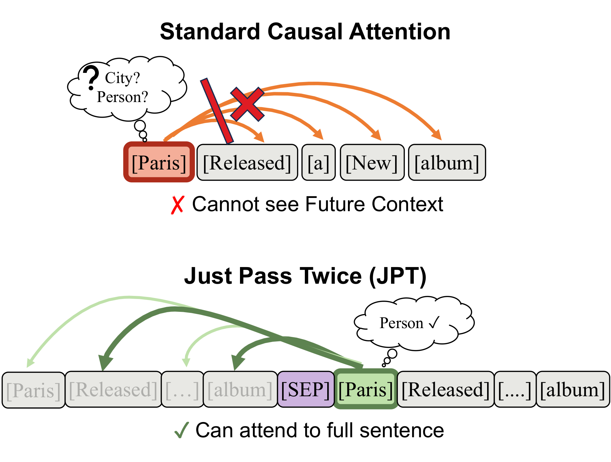
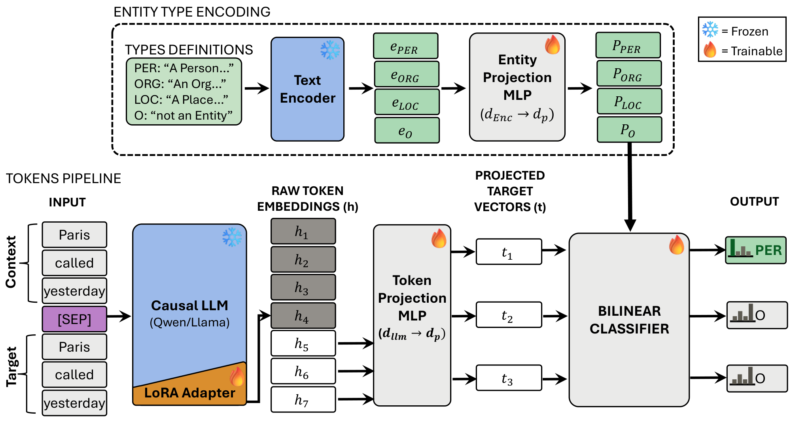
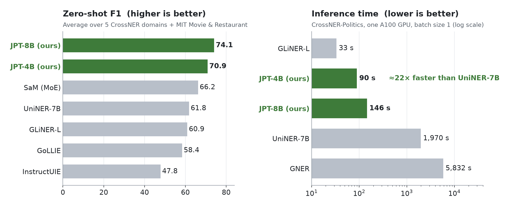

<div align="center">

# Just Pass Twice (JPT)

### Efficient Token Classification with LLMs for Zero-Shot NER

**Ahmed Ewais, Ahmed Hashish, Amr Ali**<br>
WitnessAI

**ACL 2026 (Main Conference, Long Paper)**

<a href="https://aclanthology.org/2026.acl-long.526/"></a>
<a href="https://arxiv.org/abs/2604.05158"></a>
<a href="https://witness-ai-jpt-ner.hf.space/"></a>
<a href="https://witness-ai-jpt-ner.hf.space/"></a>

<br>
<br>



</div>

**TL;DR:** Decoder-only LLMs read left to right, so while reading a word they can't see the words that come after it. That makes them poor at labeling individual tokens. JPT gives the model the text twice: every token in the second copy can look at the whole sentence. Combined with entity types described in plain language, this sets a new state of the art for zero-shot named entity recognition (+7.9 F1) and runs over 20× faster than LLMs that generate their answers.

## Highlights

- **Bidirectional context for any causal LLM.** No architecture changes and no special pretraining: just repeat the input.
- **Any entity type, zero-shot.** Describe what to tag in plain language, edge cases included, and JPT tags it without retraining.
- **State of the art.** +7.9 F1 over the best previous method on CrossNER and MIT, and ahead of GLiNER-L and UniNER-7B on 19 of 20 further benchmarks.
- **Fast.** One parallel forward pass instead of token-by-token generation: about 22× faster than UniNER-7B.
- **Light to train.** LoRA adapters and small projection heads on a frozen LLM, which is under 2% of the backbone's parameters.

## How It Works

Decoder-only LLMs use *causal* attention: each token can only look at the tokens before it. Take "Paris released a new album". When the model reads *Paris*, it hasn't seen *album* yet, so it can't tell the singer from the city.

JPT's fix is to **pass the text twice**, as `text [SEP] text`. Every token in the second copy can attend to the entire first copy, so its hidden state carries context from both sides. JPT labels only the tokens of the second copy.

<p align="center">
  
</p>

1. **Entity types as definitions.** Each entity type is a short plain-language definition, for example *LOCATION: "Any word indicating WHERE: explicit place names (Boston, downtown), relative indicators (nearby, around), directional words (east, south side)."* A text encoder embeds each definition once, offline, and a small MLP projects it into a shared space. The definitions are also written into the LLM's prompt.
2. **Tokens with full context.** A frozen causal LLM (Qwen3-4B or Qwen3-8B) with LoRA adapters reads the doubled input, and the hidden states of the second copy are projected into the same space.
3. **Matching.** A bilinear classifier scores every token against every entity type and an explicit "not an entity" class. Consecutive tokens with the same type become one entity.

Doubling the text is cheap: the model reads it in one parallel forward pass, while generative methods write their answer one token at a time.

## Results

<p align="center">
  
</p>

Zero-shot F1 on CrossNER and MIT. Baseline numbers are from Ding et al. (2025).

| Model | Type | AI | Literature | Music | Politics | Science | Movie | Restaurant | Avg |
|:--|:--|:-:|:-:|:-:|:-:|:-:|:-:|:-:|:-:|
| UniNER-7B | Generative | 62.9 | 64.9 | 70.6 | 66.9 | 70.8 | 61.2 | 35.2 | 61.8 |
| GoLLIE | Generative | 59.1 | 62.7 | 67.8 | 57.2 | 55.5 | 63.0 | 43.4 | 58.4 |
| InstructUIE | Generative | 49.0 | 47.2 | 53.2 | 48.2 | 49.3 | 63.0 | 21.0 | 47.8 |
| SaM (MoE) | Generative | 60.9 | 66.9 | 73.5 | 74.4 | 62.6 | 72.1 | 52.9 | 66.2 |
| GLiNER-L | Discriminative | 57.2 | 64.4 | 69.6 | 72.6 | 62.6 | 64.4 | 42.9 | 60.9 |
| **JPT-4B** | Discriminative | 68.3 | **73.7** | 84.1 | 76.4 | 69.5 | 60.7 | 63.4 | 70.9 |
| **JPT-8B** | Discriminative | **71.9** | 72.2 | **85.3** | **77.0** | **71.3** | **76.5** | **64.4** | **74.1** |

Both ideas matter: on JPT-4B, removing the second pass costs 15.2 F1, and using bare label names instead of definitions costs 12.6 F1.

<details>
<summary><b>20 more benchmarks</b> (biomedical, social media, multilingual): JPT-4B averages 55.5 F1, against 47.8 for GLiNER-L and 45.7 for UniNER-7B</summary>
<br>

Baseline numbers are from Zaratiana et al. (2024).

| Dataset | UniNER-7B | GLiNER-L | JPT-4B |
|:--|:-:|:-:|:-:|
| ACE05 | 36.9 | 27.3 | **44.6** |
| AnatEM | 25.1 | 33.3 | **37.2** |
| bc2gm | 46.2 | 47.9 | **54.8** |
| bc4chemd | 47.9 | 43.1 | **53.3** |
| bc5cdr | 68.0 | 66.4 | **70.4** |
| Broad Twitter | 67.9 | 61.2 | **71.2** |
| CoNLL03 | 72.2 | 64.6 | **78.1** |
| FabNER | 24.8 | 23.6 | **27.8** |
| FindVehicle | 22.2 | 41.9 | **42.3** |
| GENIA | 54.1 | **55.5** | 50.8 |
| HarveyNER | 18.2 | 22.7 | **27.7** |
| MIT Movie | 42.4 | 57.2 | **73.4** |
| MIT Restaurant | 31.7 | 42.9 | **61.9** |
| MultiNERD | 59.3 | 59.7 | **65.7** |
| NCBI | 60.4 | 61.9 | **68.7** |
| OntoNotes | 27.8 | 32.2 | **43.1** |
| PolyglotNER | 41.8 | 42.9 | **47.4** |
| TweetNER7 | 42.7 | 41.4 | **49.7** |
| WikiANN | 55.4 | 58.9 | **64.7** |
| WikiNeural | 69.2 | 71.8 | **77.3** |
| **Average** | 45.7 | 47.8 | **55.5** |

</details>

## Try It

The [Hugging Face Space](https://witness-ai-jpt-ner.hf.space/) has two ways in:

- **Demo:** paste text, pick a scenario or write your own entity definitions, and see the detected entities.
- **Reproduce & API:** request an API key for JPT-4B to extract entities programmatically or to reproduce the CrossNER and MIT results from the paper.

## Citation

If you find JPT useful, please cite our paper:

```bibtex
@inproceedings{ewais-etal-2026-just,
    title = "Just Pass Twice: Efficient Token Classification with {LLM}s for Zero-Shot {NER}",
    author = "Ewais, Ahmed  and
      Hashish, Ahmed  and
      Ali, Amr",
    editor = "Liakata, Maria  and
      Moreira, Viviane P.  and
      Zhang, Jiajun  and
      Jurgens, David",
    booktitle = "Proceedings of the 64th Annual Meeting of the {A}ssociation for {C}omputational {L}inguistics (Volume 1: Long Papers)",
    month = jul,
    year = "2026",
    address = "San Diego, California, United States",
    publisher = "Association for Computational Linguistics",
    url = "https://aclanthology.org/2026.acl-long.526/",
    doi = "10.18653/v1/2026.acl-long.526",
    pages = "11480--11497",
    ISBN = "979-8-89176-390-6"
}
```
